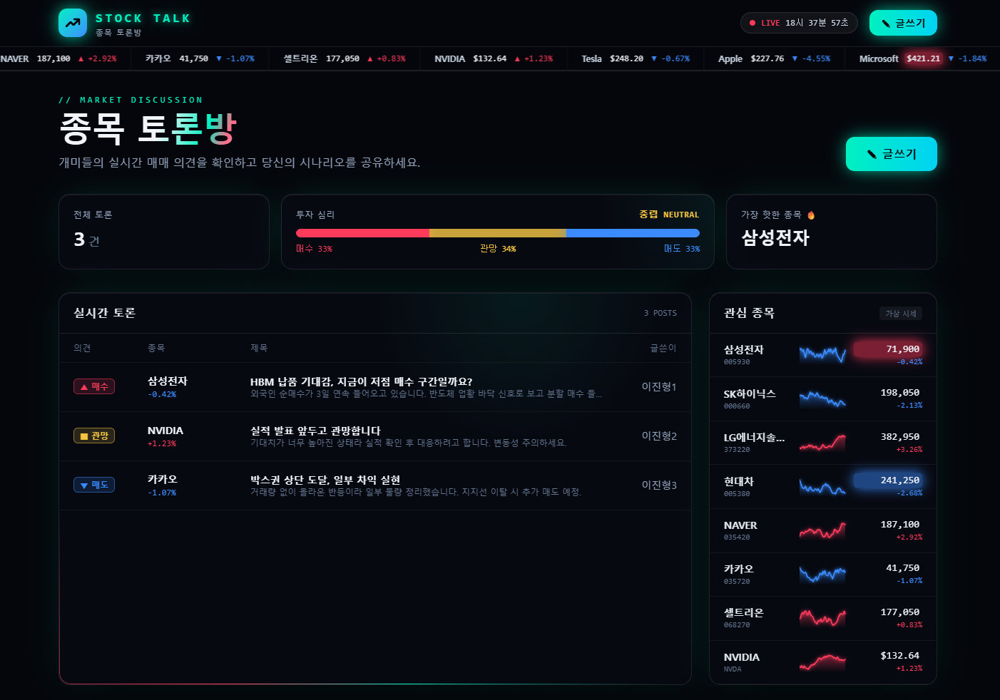
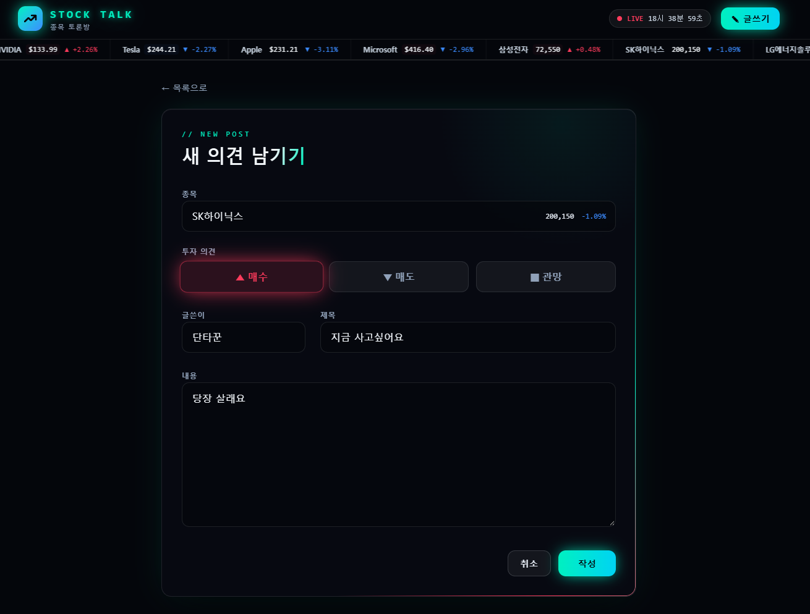
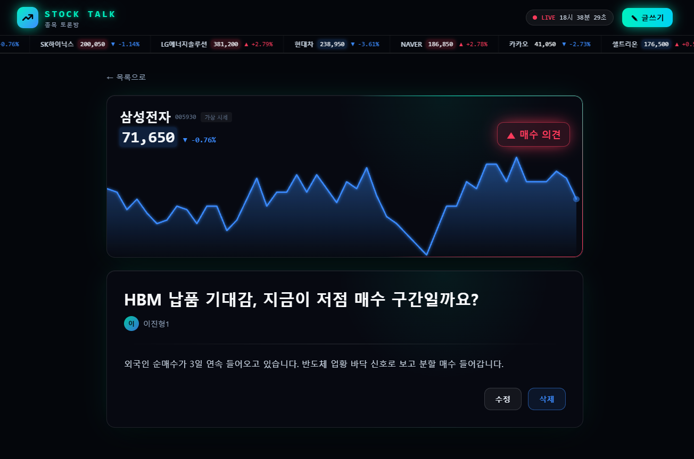

# STOCK TALK · 주식 종목 토론방 (Vue Board)

Vue.js로 구축된 주식 종목 토론 게시판 웹 애플리케이션입니다.

## 📋 프로젝트 소개

이 프로젝트는 Vue.js 3를 사용하여 제작된 주식 종목별 매매 의견을 나누는 게시판 기능을 제공하는 싱글 페이지 애플리케이션(SPA)입니다. 사용자는 게시글을 조회, 작성, 수정, 삭제할 수 있습니다.

## ✨ 주요 기능

- 📖 **게시글 목록 조회**: 모든 게시글을 의견(매수/매도/관망)·종목·등락률과 함께 확인할 수 있습니다
- 📊 **투자 심리 지표**: 전체 게시글의 매수/관망/매도 비율과 가장 많이 언급된 종목을 보여줍니다
- 📈 **실시간 시세 연출**: 상단 시세 전광판, 관심 종목 미니 차트, 상세 화면 차트 (연출용 가상 시세)
- ✍️ **게시글 작성**: 종목과 투자 의견을 선택해 새로운 게시글을 작성할 수 있습니다
- 📝 **게시글 수정**: 기존 게시글을 수정할 수 있습니다
- 🗑️ **게시글 삭제**: 기존 게시글을 삭제할 수 있습니다
- 👁️ **게시글 상세 보기**: 개별 게시글의 상세 내용을 확인할 수 있습니다

## 🛠️ 기술 스택

- **프론트엔드**: Vue.js 3.5
- **라우터**: Vue Router 5
- **스타일**: Tailwind CSS 4
- **빌드 도구**: Vite 8
- **테스트**: Vitest 5 + Vue Test Utils
- **언어**: JavaScript (ES6+)

## 📁 프로젝트 구조

```
vue-board/
├── src/
│   ├── App.vue                 # 루트 컴포넌트
│   ├── main.js                 # 애플리케이션 진입점
│   ├── components/             # Vue 컴포넌트들
│   │   ├── Create.vue          # 게시글 작성/수정 컴포넌트
│   │   ├── Read.vue            # 게시글 목록 컴포넌트
│   │   ├── Detail.vue          # 게시글 상세 보기 컴포넌트
│   │   ├── TickerTape.vue      # 상단 시세 전광판
│   │   ├── Sparkline.vue       # 미니 시세 차트
│   │   └── MarketBackground.vue # 배경 애니메이션 (그리드/차트 라인/파티클)
│   ├── data/                   # 데이터 관리
│   │   ├── index.js            # 게시판 데이터
│   │   └── market.js           # 연출용 가상 시세 데이터
│   ├── lib/opinion.js          # 투자 의견(매수/매도/관망) 정의
│   ├── style.css               # Tailwind 및 공통 스타일/애니메이션
│   ├── router/                 # 라우팅 설정
│   │   └── index.js            # 라우터 구성
│   └── assets/                 # 정적 자원
├── tests/                      # 테스트 파일들 (Vitest)
├── index.html                  # HTML 진입점
└── vite.config.js              # Vite 빌드/개발 서버 설정
```

## 🚀 시작하기

### 필수 요구사항

- Node.js (v22.22.2 이상 또는 v24.15.0 이상)
- npm 또는 yarn

### 설치 및 실행

1. **저장소 클론**

   ```bash
   git clone <repository-url>
   cd vue-board
   ```

2. **의존성 설치**

   ```bash
   npm install
   ```

3. **개발 서버 실행**

   ```bash
   npm run dev
   # 또는
   npm start
   ```

4. **브라우저에서 확인**
   - 개발 서버가 실행되면 브라우저에서 `http://localhost:3000`으로 접속합니다. 3000 포트가 사용 중이면 다른 포트가 자동으로 할당되며, 터미널에 실제 주소가 표시됩니다

### 빌드

프로덕션 빌드를 생성하려면:

```bash
npm run build
```

빌드된 파일들은 `dist/` 폴더에 생성됩니다.

### 테스트

단위 테스트를 실행하려면:

```bash
npm run test
# 또는
npm run unit
```

## 📱 사용법

1. **게시글 목록 보기**: 메인 페이지에서 모든 게시글을 확인할 수 있습니다
2. **게시글 작성**: "글쓰기" 버튼을 클릭하여 새 게시글을 작성합니다
3. **게시글 상세 보기**: 목록에서 게시글을 클릭하면 상세 내용을 볼 수 있습니다
4. **게시글 수정**: 상세 보기에서 수정 버튼을 클릭하여 게시글을 편집할 수 있습니다

## 🔧 개발 스크립트

- `npm run dev`: 개발 서버 시작
- `npm run build`: 프로덕션 빌드
- `npm run preview`: 빌드 결과물 미리보기
- `npm run test`: 테스트 실행
- `npm start`: 개발 서버 시작 (dev와 동일)

## 📝 컴포넌트 설명

### Read.vue

- 게시글 목록을 테이블 형태로 표시 (의견 배지, 종목 등락률)
- 투자 심리 게이지, 관심 종목 시세 패널
- 각 게시글 클릭 시 상세 보기로 이동
- 새 게시글 작성 버튼 제공

### Create.vue

- 새 게시글 작성 폼
- 게시글 수정 폼 (라우트 파라미터에 따라 동적 변경)
- 종목(자동완성), 투자 의견, 글쓴이, 제목, 내용 입력 필드 제공

### Detail.vue

- 개별 게시글의 상세 정보와 종목 시세 차트 표시
- 수정 및 삭제 기능 제공

## 🎨 디자인

### 메인 화면


### 글 쓰기 화면


### 글 읽기 화면

